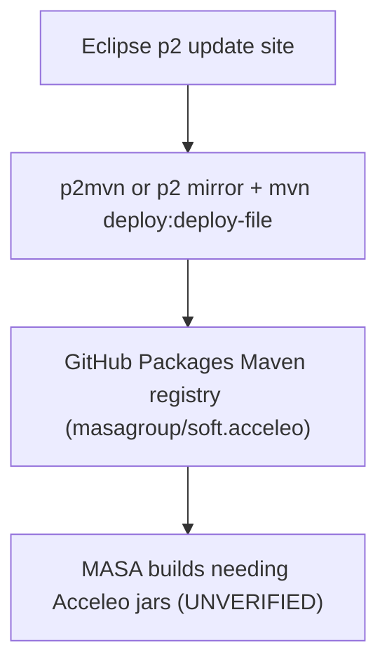
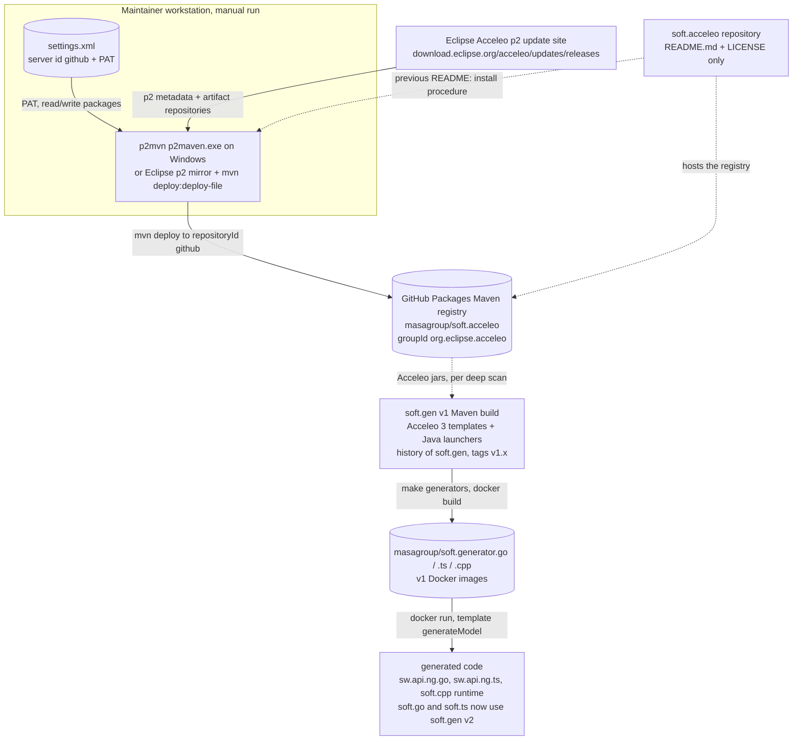
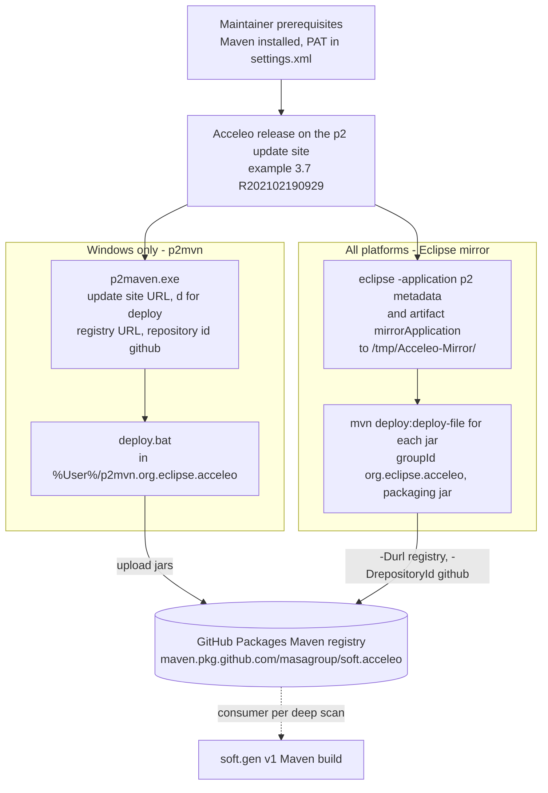

# soft.acceleo: architecture

> Technical choices, diagrams and internal structure of `soft.acceleo`. Back to the [README](README.md) · [Contributing](CONTRIBUTING.md) · [repository on GitHub](https://github.com/masagroup/soft.acceleo)

| | |
|---|---|
| **Family** | Ecore / esync |
| **Kind** | empty stub (artifact-hosting repo; only `README.md` and `LICENSE`) |
| **Languages** | none (Markdown only) |
| **Remote / branch** | github.com/masagroup/soft.acceleo, default branch `main` |
| **Generation** | stub |
| **Build systems** | none (manual Maven deploy procedure described in `README.md`) |

## Overview

The repository in its ecosystem (the text is in the [README](README.md#overview)):



## Position in the ecosystem

Unrelated to all next-gen services (gateway, history, esync, dos, storage, authentication, node, orchestrator, commander, hub, recorder, timeline, mapserver, webclient, datacore, dispatcher, HLA). Only indirectly adjacent to the ecore model: Acceleo is an Eclipse EMF/MTL generator commonly used to generate code from Ecore models, but nothing in this repo references a MASA ecore model. See the ecosystem wiki page [esync and ecore](https://github.com/masagroup/wiki/wiki/esync-ecore).

## Repository layout

```
README.md   purpose and manual deploy procedure (previously Readme.md)
LICENSE     Mozilla Public License 2.0
```

## Architecture

Flat repository. Data flow is manual and maintainer-run: Eclipse p2 update site, then local mirror or `p2mvn` conversion, then `mvn deploy` to GitHub Packages (`masagroup/soft.acceleo`), then, by intent, consumption by builds that need Acceleo artifacts (consumers UNVERIFIED).

## How it works

soft.acceleo builds nothing and runs nothing: its working tree holds only `README.md` (previously `Readme.md`) and `LICENSE` (Mozilla Public License 2.0), with no source, build file, Dockerfile or CI workflow, and a git history of 3 commits. It exists to back a Maven registry on GitHub Packages, `https://maven.pkg.github.com/masagroup/soft.acceleo`, which stores Eclipse Acceleo releases (Acceleo is the MTL model-to-text template engine) that are missing from the Eclipse Maven repository `repo.eclipse.org`. The input is an Acceleo release on the Eclipse p2 update site. The output is a set of jars under groupId `org.eclipse.acceleo`, deployed by hand by a maintainer with a GitHub personal access token. The jars live in the registry, never in the repository.

### Components and data flow

Every box below exists today: nothing in this page is planned. The only moving parts are a maintainer, third-party tools and the GitHub Packages registry.



- **Nothing runs on its own.** The scan found no executable, service, port, configuration file or environment variable. A maintainer runs the procedure of the previous README (`Readme.md` on `masa/main`) by hand, with either the third-party KinoriTech `p2mvn` converter (Windows only) or the Eclipse p2 mirror applications plus Maven (all platforms).
- **What is read and written.** The procedure reads one Acceleo release from the p2 update site (the example of the previous README is Acceleo 3.7, `R202102190929`) and writes jars under groupId `org.eclipse.acceleo` to the registry attached to `masagroup/soft.acceleo`. The registry cannot be inspected from the working tree, so the list of versions published today is UNVERIFIED.
- **Authentication.** Publishing uses a GitHub personal access token with read/write packages rights, stored in `%User%/.m2/settings.xml` under a `<server><id>github</id>` entry and selected by `-DrepositoryId=github`.
- **Who consumes the registry.** The transverse analysis (soft.* inventory) names the `soft.gen` build as consumer. That is soft.gen v1: its Acceleo templates (`*.mtl`) and Java launchers (Java 25, Acceleo 3, Maven) built the `masagroup/soft.generator.{go,ts,cpp}` images and now live in the history of soft.gen (tags `v1.x`), because soft.gen master is made of Go `text/template` generators (one `soft.gen` command, no Acceleo, no Maven) and the v1 images remain for v1. sw.api.ng.go and sw.api.ng.ts still run those images (no tag, so `latest`, per their pages) to generate the next gen model API and the `soft.cpp` `build.xml` still uses one (which version each repository pins is UNVERIFIED), whereas the `soft.go` and `soft.ts` Makefiles now run soft-gen of soft.gen v2. The wiki page and the repository scan found no reference to that consumer from soft.acceleo itself, and both list the consumers as an open question (UNVERIFIED): no current consumer of the registry is known.
- **Place in the generation chain.** The deep analysis notes that a change of generator templates ripples `soft.gen` → runtimes → `sw.api.ng.*` → consumers. If the soft.gen link holds, soft.acceleo sits one step before soft.gen v1, as a source of build-time jars only; soft.gen v2 needs no Acceleo jar. The wiki page classifies it as a stub, a shared support repository of the Ecore / esync stack (soft.*), unrelated to gateway, history, esync, dos, storage, authentication, node, orchestrator, commander, hub, recorder, timeline, mapserver, webclient, datacore, dispatcher and HLA, and only indirectly adjacent to the ecore model.
- **No internal dependency.** No `<update>` or `<update-gh>`, no `FROM masagroup/*`, no `.gitmodules`, no `go.mod` and no `package.json`: the repository depends on no other MASA repository.

### From sources to artifacts

There is no build system. The diagram shows the two manual publication paths described in the previous README (`Readme.md`).



- **No build, no CI.** There is no `build.xml`, `Dockerfile`, `docker-compose.yaml`, `CMakeLists.txt`, `go.mod`, `Makefile` or `package.json`, and no `.github/` directory. No shared `masagroup/cicd` workflow runs and CI produces no artifact; the only artifacts are the Maven jars in the registry, published by a person.
- **Two paths, same result.** On Windows, `p2maven.exe` (from `github.com/KinoriTech/p2mvn`) takes the update site URL, `d` (deploy), the registry URL and the repository id `github`, then `%User%/p2mvn.org.eclipse.acceleo/deploy.bat` is run. On any platform, `eclipse -nosplash -verbose -application org.eclipse.equinox.p2.metadata.repository.mirrorApplication` and the matching `artifact.repository.mirrorApplication` mirror the update site (`-source <update site>`) to `-destination file:/tmp/Acceleo-Mirror/`, then `mvn deploy:deploy-file -DgroupId=org.eclipse.acceleo -DartifactId=<id> -Dversion=<v> -Dpackaging=jar -Dfile=<id>_<v>.jar -DrepositoryId=github -Durl=https://maven.pkg.github.com/masagroup/soft.acceleo` runs once per jar. No tool version is pinned (Maven not pinned, p2mvn "latest release"), and the availability of the third-party p2mvn tool is UNVERIFIED.
- **Points to watch (no audit exists).** The previous README stores the PAT in clear text in `settings.xml`, and the scan recommends moving publication to CI with scoped tokens if the process is ever automated. The example of the previous README (Acceleo 3.7, 2021) is possibly outdated: newer releases may exist on the update site (not checked). The previous `Readme.md` also lacked a trailing newline after its last code fence (cosmetic; the file was replaced by `README.md`).
- **Remotes.** The canonical repository is `github.com/masagroup/soft.acceleo` (remotes `masa` and `upstream`, matching the registry URL), default branch `main`.

## Dependencies

### Internal (MASA repositories)

None. No `<update>`/`<update-gh>`, no Docker `FROM masagroup/*`, no submodule, no `go.mod` or `package.json`. The registry is intended as a source of Acceleo jars for other MASA builds; consumers are UNVERIFIED (see the [open questions](https://github.com/masagroup/wiki/wiki/known-issues#soft.acceleo)).

### External

| Dependency | Use | Version |
|---|---|---|
| Eclipse Acceleo p2 update site | upstream source of releases | example 3.7 (R202102190929), no pin in repo |
| Maven (`mvn deploy:deploy-file`) | publish jars | not pinned |
| KinoriTech `p2mvn` | p2 to Maven converter (Windows) | latest release |
| GitHub Packages (Maven) | registry hosting | n/a |
