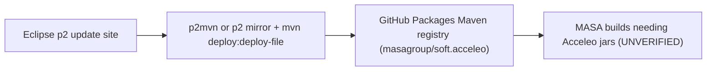

---
sword:
  schema: 1
  name: soft.acceleo
  family: ecore-esync
  kind: stub
  generation: stub
  shipped: false
  languages: [Markdown]
  build: [none]
  ng: []
  apps: []
---

# soft.acceleo

> Stub repository that holds no code: it backs a Maven registry on GitHub Packages for Eclipse Acceleo releases that are missing from the Eclipse Maven repository.

| | |
|---|---|
| **Family** | Ecore / esync |
| **Kind** | empty stub (artifact-hosting repo; only `Readme.md` and `LICENSE`) |
| **Languages** | none (Markdown only) |
| **Remote / branch** | github.com/masagroup/soft.acceleo, default branch `main` |
| **Generation** | stub |
| **Build systems** | none (manual Maven deploy procedure described in `Readme.md`) |

## Overview

The repository exists to back the Maven repository `https://maven.pkg.github.com/masagroup/soft.acceleo` (GitHub Packages). That registry stores releases of Eclipse Acceleo (the MTL model-to-text template engine) that are not available on `repo.eclipse.org`. Releases are taken from the p2 update site `https://download.eclipse.org/acceleo/updates/releases/`, converted to Maven artifacts (groupId `org.eclipse.acceleo`) and deployed by hand by a maintainer. The artifacts live in the GitHub Packages registry, not in the working tree. License: Mozilla Public License 2.0 (`LICENSE`). Git history: 3 commits (`Initial commit`, `Add readme`, `Format readme`).



## Repository layout

```
Readme.md   purpose and "How to install new version" procedure
LICENSE     Mozilla Public License 2.0
```

## Build

No `build.xml`, `Dockerfile`, `docker-compose.yaml`, `CMakeLists.txt`, `go.mod`, `Makefile` or `package.json`: nothing to build.

### Other (manual publication of a new Acceleo version)

Procedure from `Readme.md`:

1. Install Maven.
2. Create a GitHub personal access token with read/write packages rights and put it in `%User%/.m2/settings.xml` under a `<server><id>github</id>` entry.
3. Then either:
   - Windows only: download `p2mvn` (`https://github.com/KinoriTech/p2mvn`), run `p2maven.exe` with the p2 update site URL, `d` (deploy), the repository URL `https://maven.pkg.github.com/masagroup/soft.acceleo` and repository id `github`, then run `%User%/p2mvn.org.eclipse.acceleo/deploy.bat`.
   - All platforms: mirror the p2 metadata and artifact repositories with `eclipse -nosplash -verbose -application org.eclipse.equinox.p2.metadata.repository.mirrorApplication` and `...artifact.repository.mirrorApplication` (`-source <update site>`, `-destination file:/tmp/Acceleo-Mirror/`), then for each jar run:
     `mvn deploy:deploy-file -DgroupId=org.eclipse.acceleo -DartifactId=<id> -Dversion=<v> -Dpackaging=jar -Dfile=<id>_<v>.jar -DrepositoryId=github -Durl=https://maven.pkg.github.com/masagroup/soft.acceleo`

The example in the Readme uses Acceleo 3.7 (`.../releases/3.7/R202102190929/`).

## Dependencies

### Internal (MASA repositories)

None. No `<update>`/`<update-gh>`, no Docker `FROM masagroup/*`, no submodule, no `go.mod` or `package.json`. The registry is intended as a source of Acceleo jars for other MASA builds; consumers are UNVERIFIED (see Open questions).

### External

| Dependency | Use | Version |
|---|---|---|
| Eclipse Acceleo p2 update site | upstream source of releases | example 3.7 (R202102190929), no pin in repo |
| Maven (`mvn deploy:deploy-file`) | publish jars | not pinned |
| KinoriTech `p2mvn` | p2 to Maven converter (Windows) | latest release |
| GitHub Packages (Maven) | registry hosting | n/a |

## Architecture

Flat repository. Data flow is manual and maintainer-run: Eclipse p2 update site, then local mirror or `p2mvn` conversion, then `mvn deploy` to GitHub Packages (`masagroup/soft.acceleo`), then, by intent, consumption by builds that need Acceleo artifacts (consumers UNVERIFIED).

## CI/CD

No `.github/` directory and no workflows. No shared [cicd](https://github.com/masagroup/cicd) workflow is used and CI produces no artifact (see the ecosystem wiki page "CI/CD pipelines"). Publication is manual with a personal access token with read/write packages rights; the Readme stores that token in clear text in `settings.xml`.

## Next-gen relevance

Unrelated to all next-gen services (gateway, history, esync, dos, storage, authentication, node, orchestrator, commander, hub, recorder, timeline, mapserver, webclient, datacore, dispatcher, HLA). Only indirectly adjacent to the ecore model: Acceleo is an Eclipse EMF/MTL generator commonly used to generate code from Ecore models, but nothing in this repo references a MASA ecore model. See the ecosystem wiki page "esync and ecore".

## Known issues

- No audit exists. The Readme example version (Acceleo 3.7 R202102190929, 2021) is possibly outdated; newer releases may exist on the update site (not checked).
- The Readme has no trailing newline after its last code fence (cosmetic).

## Open questions

- UNVERIFIED: which Acceleo versions are currently published in the GitHub Packages registry of `masagroup/soft.acceleo`.
- UNVERIFIED: which MASA repositories consume these artifacts and for what (likely ecore/EMF code generation or Ant/Maven Java tooling).
- UNVERIFIED: whether MASA uses Acceleo templates for ecore code generation.
- UNVERIFIED: availability of the third-party `github.com/KinoriTech/p2mvn` tool.

## Legacy notes

*Content kept from the previous README, not re-verified against the code.*

### Soft Acceleo

Acceleo: https://www.eclipse.org/acceleo/ ; Eclipse Maven repository: https://repo.eclipse.org

### How to install new version

Settings file `%User%/.m2/settings.xml` (step 2):

```
<settings xmlns="http://maven.apache.org/SETTINGS/1.0.0" xmlns:xsi="http://www.w3.org/2001/XMLSchema-instance"
      xsi:schemaLocation="http://maven.apache.org/SETTINGS/1.0.0 https://maven.apache.org/xsd/settings-1.0.0.xsd">
      <servers>
		<server>
			<id>github</id>
			<username>[GITHUB USERNAME]</username>
			<password>[GENERATED ACCESS TOKEN]</password>      
		</server>
	  </servers>
</settings>
```

Mirror the p2 update site with Eclipse (all platforms), metadata repository then artifact repository:

```
eclipse -nosplash -verbose
-application org.eclipse.equinox.p2.metadata.repository.mirrorApplication
-source Insert Source URL (e.g https://download.eclipse.org/acceleo/updates/releases/3.7/R202102190929/)
-destination Insert Destination URL (e.g. file:/tmp/Acceleo-Mirror/)
```

```
eclipse -nosplash -verbose
-application org.eclipse.equinox.p2.artifact.repository.mirrorApplication
-source Insert Source URL (e.g https://download.eclipse.org/acceleo/updates/releases/3.7/R202102190929/)
-destination Insert Destination URL (e.g. file:/tmp/Acceleo-Mirror/)
```

Deploy each jar of the mirror:

```
mvn deploy:deploy-file -DgroupId=org.eclipse.acceleo -DartifactId=[artifactID] -Dversion=[version] -Dpackaging=jar -Dfile=[artifactID]_[version].jar -DrepositoryId=github -Durl=https://maven.pkg.github.com/masagroup/soft.acceleo
```
